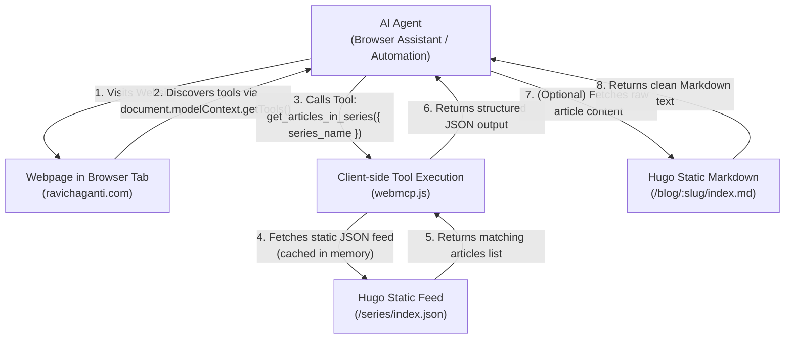

# Adding WebMCP Support to Hugo Static Sites


[Model Context Protocol](https://modelcontextprotocol.io/) (MCP) isn't new anymore, and it isn't just another evolving standard. It's widely adopted and considered a critical part of agentic AI. Server-side MCP is powerful, but what happens when an AI agent needs to interact with the **web**?

Until recently, when an autonomous agent browses a website, it behaves like a human looking at a screen: it scrapes the Document Object Model (DOM), parses accessibility trees, takes screenshots, and guesses which CSS selectors to click or forms to submit. This "UI actuation" approach is slow, brittle, token-expensive, and breaks the moment a CSS class or layout shifts.

Enter **[WebMCP](https://webmcp.dev/)** (Web Model Context Protocol). WebMCP brings the philosophy of MCP directly into the browser tab. Instead of forcing agents to reverse-engineer HTML, websites can explicitly register typed, callable JavaScript tools with natural language descriptions and JSON Schemas right into the browser's execution context.

In this article, we will explore what WebMCP is, compare it with standard server-side MCP, and implement a complete, production-ready WebMCP integration on a Hugo static website without running any server infrastructure.

## Server MCP vs. WebMCP: What is the Difference?

While they share terminology and architectural principles, **Server MCP** and **WebMCP** operate at different layers of the technology stack:

| Dimension | Anthropic Model Context Protocol (MCP) | WebMCP (Web Model Context Protocol) |
| :--- | :--- | :--- |
| **Layer** | Backend / Server-to-Client | Frontend / In-Browser DOM |
| **Transport** | `stdio`, Server-Sent Events (SSE), Streamable HTTP | In-page JavaScript API (`document.modelContext`) |
| **Standardization** | Anthropic open-source protocol specification | Incubated by W3C Web Machine Learning CG (`webmachinelearning/webmcp`) |
| **Primary Consumers**| Desktop AI assistants (Claude Desktop, Cursor, local IDEs) | Browser-integrated AI, agent extensions, headless automation |
| **Execution Context**| Local machine processes or cloud servers | Inside the visitor's browser tab |
| **Hosting Requirement**| Requires active server or serverless compute | **Runs in static client-side JavaScript** |

With server-side MCP, the AI client speaks JSON-RPC 2.0 to an independent process or server over HTTP or stdio. 

With **WebMCP**, the web application itself becomes the tool provider. When an agent visits your website, the browser provides a standardized interface—`document.modelContext`—where the website registers its functions. The agent inspects available tools and invokes them deterministically with structured JSON inputs.

## Why Hugo and Static Sites Are an Ideal Fit

At first glance, providing dynamic AI tools might sound like something requiring a Node.js, Python, or Go backend. However, IMHO, static websites are actually the ultimate sweet spot for WebMCP:

1. **Build-Time Computation**: Static site generators like Hugo already know everything about your content at build time—taxonomies, series, post metadata, categories, tags, and relationship graphs.
2. **Zero Server Overhead**: The tools run entirely in the visitor's browser using client-side JavaScript. There are no API keys to manage on a server, no database connection pools, and no serverless function cold starts.
3. **CDN Speed**: Static JSON feeds download in milliseconds from edge CDNs or GitHub Pages.
4. **Deterministic Accuracy**: Because the data is compiled directly from the site's Markdown front matter, tools return exact, zero-hallucination results.

Here is how the end-to-end flow works when an AI agent visits a Hugo site equipped with WebMCP:



Instead of scraping pages or running costly OCR on article cards, the agent queries the site's tool registry and receives structured JSON responses in single-digit milliseconds.

## Generating Lightweight JSON Feeds in Hugo

For in-browser tools to answer questions like *"What article series exist?"* or *"List all articles in the Model Context Protocol series"*, the client-side JavaScript needs structured data.

### Avoiding the Payload Size Trap

A common mistake in Hugo is writing a monolithic search index layout that dumps `.Plain` (the full text of every post) into a single `/index.json` file. On an active blog with dozens or hundreds of posts containing diagrams, tables, and code snippets, this file can balloon to **50–60 megabytes**! Fetching 60MB inside a visitor's browser for an AI tool is unacceptable.

Instead, we generate a lean taxonomy feed specifically for series and article metadata.

### Creating the Series Taxonomy Layout

In your Hugo site, create a custom layout file at `layouts/_default/taxonomy.json`:

```go-html-template
{{- $seriesList := slice -}}
{{- range $key, $value := .Site.Taxonomies.series -}}
  {{- $seriesPages := slice -}}
  {{- range $value.Pages.ByDate -}}
    {{- $mdURL := printf "%sindex.md" .RelPermalink -}}
    {{- $seriesPages = $seriesPages | append (dict "title" .Title "slug" .Slug "url" .Permalink "markdown_url" $mdURL "date" (.Date.Format "2006-01-02") "excerpt" (.Params.excerpt | default .Summary | plainify)) -}}
  {{- end -}}
  {{- $seriesList = $seriesList | append (dict "name" $value.Page.Title "slug" ($key | urlize) "url" (printf "/series/%s/" ($key | urlize) | absURL) "count" (len $value.Pages) "articles" $seriesPages) -}}
{{- end -}}
{{- $seriesList | jsonify -}}
```

Next, configure Hugo in `hugo.toml` to output JSON for taxonomies:

```toml
[outputs]
  home = ["HTML", "JSON", "LLMS"]
  section = ["HTML"]
  taxonomy = ["HTML", "JSON"]
  page = ["HTML", "Markdown"]
```

When Hugo builds your site, it compiles `/series/index.json`. For 37 series and hundreds of articles, this entire file is only **~150 KB** (and under 30 KB gzipped).

## Exploiting Hugo's Native Markdown Output

AI agents love raw Markdown—it is token-efficient, preserves headings and code blocks, and avoids HTML boilerplate.

Hugo has built-in support for multiple output formats per page. By defining a Markdown output format and template (`layouts/_default/single.md`):

```go-html-template
# {{ .Title }}

{{ .RawContent }}
```

Every blog post on your site is automatically accessible as raw Markdown simply by requesting `/blog/<slug>/index.md`.

When an agent needs the full content of an article, our WebMCP tool can fetch this static `.md` file directly.

## Implementing the WebMCP Client Script

Now, let's create the client-side JavaScript file at `static/js/webmcp.js`.

### Polyfill and Native Detection

The WebMCP specification is currently being incubated in the W3C Web Machine Learning Community Group. While Chromium supports it behind experimental flags (`chrome://flags/#enable-webmcp-testing`), most consumer browsers don't enable it by default yet.

To ensure backward compatibility and allow browser extensions, headless automation scripts (Playwright/Puppeteer), and DevTools testing to work immediately, we provide an in-page shim if `document.modelContext` is not natively present:

```javascript
// Check for native browser support
const isNative = typeof document !== 'undefined' && 'modelContext' in document;
const registry = new Map();

if (!isNative) {
  document.modelContext = {
    async registerTool(toolDef, options) {
      if (!toolDef || !toolDef.name) {
        throw new Error("WebMCP: Tool definition must include a 'name'.");
      }
      registry.set(toolDef.name, toolDef);

      if (options && options.signal) {
        options.signal.addEventListener('abort', () => {
          registry.delete(toolDef.name);
        });
      }

      document.dispatchEvent(
        new CustomEvent('modelcontext:toolregistered', {
          detail: { name: toolDef.name, tool: toolDef }
        })
      );
      return true;
    },

    async unregisterTool(name) {
      return registry.delete(name);
    },

    async getTools() {
      return Array.from(registry.values()).map(t => ({
        name: t.name,
        title: t.title || t.name,
        description: t.description,
        inputSchema: t.inputSchema,
        annotations: t.annotations || { readOnlyHint: true }
      }));
    },

    async executeTool(name, params = {}) {
      const tool = registry.get(name);
      if (!tool) throw new Error(`WebMCP: Tool '${name}' not found.`);
      return await tool.execute(params);
    }
  };
}
```

### Registering the Tools

We register 5 core tools designed for agents exploring technical content:

#### Tool 1: `list_article_series`
Returns all technical series on the blog with post counts and links.

```javascript
await document.modelContext.registerTool({
  name: "list_article_series",
  title: "List Article Series",
  description: "Returns all technical article series published on Ravikanth Chaganti's blog, including the series title, URL slug, number of articles, and series link.",
  inputSchema: {
    type: "object",
    properties: {},
    additionalProperties: false
  },
  annotations: { readOnlyHint: true, consequentialHint: false },
  async execute() {
    const data = await fetchSeriesData();
    const list = data.map(s => ({
      name: s.name,
      slug: s.slug,
      articleCount: s.count,
      url: s.url
    }));
    return JSON.stringify({ totalSeries: list.length, series: list }, null, 2);
  }
});
```

#### Tool 2: `get_articles_in_series`
Allows an agent to drill down into a specific series by name or slug:

```javascript
await document.modelContext.registerTool({
  name: "get_articles_in_series",
  title: "Get Articles in Series",
  description: "Returns all articles belonging to a specific series (e.g. 'Model Context Protocol', 'Microsoft Agent Framework', 'Google ADK', 'Azure Bicep') with titles, dates, excerpts, permalinks, and markdown source URLs.",
  inputSchema: {
    type: "object",
    properties: {
      series_name: {
        type: "string",
        description: "The name or slug of the series (case-insensitive)"
      }
    },
    required: ["series_name"],
    additionalProperties: false
  },
  annotations: { readOnlyHint: true, consequentialHint: false },
  async execute({ series_name }) {
    const data = await fetchSeriesData();
    const query = series_name.trim().toLowerCase();
    const match = data.find(s => 
      s.name.toLowerCase() === query || 
      s.slug.toLowerCase() === query ||
      s.name.toLowerCase().includes(query)
    );

    if (!match) {
      return JSON.stringify({
        error: `Series '${series_name}' not found.`,
        availableSeries: data.map(s => s.name)
      }, null, 2);
    }

    return JSON.stringify({
      series: match.name,
      articleCount: match.count,
      url: match.url,
      articles: match.articles
    }, null, 2);
  }
});
```

#### Tool 3: `search_articles`
Allows an agent to search across all posts by keywords, tags, or topics:

```javascript
await document.modelContext.registerTool({
  name: "search_articles",
  title: "Search Articles",
  description: "Search blog posts by keyword, technology, or topic across the entire blog archive.",
  inputSchema: {
    type: "object",
    properties: {
      query: { type: "string", description: "Search keyword or phrase" },
      limit: { type: "integer", description: "Max results (default 10)", default: 10 }
    },
    required: ["query"],
    additionalProperties: false
  },
  annotations: { readOnlyHint: true, consequentialHint: false },
  async execute({ query, limit = 10 }) {
    const data = await fetchArticlesData();
    const q = query.trim().toLowerCase();
    const terms = q.split(/\s+/).filter(Boolean);
    const toArray = (v) => Array.isArray(v) ? v : (v ? [v] : []);

    const scored = [];
    for (const item of data) {
      let score = 0;
      const title = (item.title || '').toLowerCase();
      const excerpt = (item.excerpt || '').toLowerCase();
      const categories = toArray(item.categories).join(' ').toLowerCase();
      const series = toArray(item.series).join(' ').toLowerCase();

      for (const term of terms) {
        if (title.includes(term)) score += 10;
        if (series.includes(term)) score += 6;
        if (categories.includes(term)) score += 4;
        if (excerpt.includes(term)) score += 2;
      }

      if (score > 0) scored.push({ score, item });
    }

    scored.sort((a, b) => b.score - a.score);
    return JSON.stringify({
      query,
      results: scored.slice(0, limit).map(s => s.item)
    }, null, 2);
  }
});
```

#### Tool 4: `get_article_content`
Fetches the raw Markdown content of an article on demand:

```javascript
await document.modelContext.registerTool({
  name: "get_article_content",
  title: "Get Article Markdown Content",
  description: "Fetches the full markdown content of an article given its permalink URL, path, or slug.",
  inputSchema: {
    type: "object",
    properties: {
      url_or_slug: {
        type: "string",
        description: "The full permalink URL, relative path, or slug of the article"
      }
    },
    required: ["url_or_slug"],
    additionalProperties: false
  },
  annotations: { readOnlyHint: true, consequentialHint: false },
  async execute({ url_or_slug }) {
    let target = url_or_slug.trim();
    if (!target.includes('/') && !target.startsWith('http')) {
      target = `/blog/${target}/index.md`;
    } else if (!target.endsWith('.md')) {
      target = target.endsWith('/') ? `${target}index.md` : `${target}/index.md`;
    }

    const res = await fetch(target);
    if (!res.ok) {
      return JSON.stringify({ error: `Article markdown not found at '${target}'.` });
    }
    const markdown = await res.text();
    return JSON.stringify({ source: target, content: markdown }, null, 2);
  }
});
```

#### Tool 5: `get_author_info`
Returns structured author metadata, core technical domains, and social profiles.

## Integrating with Hugo Layouts & Discovery

To activate the script and announce WebMCP capabilities to visiting agents:

1. **Include the script** in your base template (`layouts/_default/baseof.html`):
   ```html
   {{/* WebMCP Script - Model Context Protocol for AI Agents */}}
   <script defer src="{{ "/js/webmcp.js" | relURL }}"></script>
   ```

2. **Add discovery metadata** in `layouts/partials/head.html`:
   ```html
   {{/* WebMCP & AI Agent Discovery */}}
   <meta name="model-context" content="enabled">
   <link rel="alternate" type="application/json" title="Series Catalog" href="{{ "/series/index.json" | absURL }}">
   <link rel="alternate" type="application/json" title="Articles Index" href="{{ "/index.json" | absURL }}">
   ```

## Testing WebMCP Directly in the Browser

Once deployed or running locally with `hugo server`, you can test your WebMCP tools immediately.

### The DevTools Console (F12)

Open your browser's Developer Tools (`F12`), switch to the **Console** tab, and test the tools interactively:

```javascript
// 1. Inspect all discovered tools and schemas
const tools = await document.modelContext.getTools();
console.table(tools.map(t => ({ name: t.name, description: t.description })));

// 2. Discover all article series
const series = await window.runWebMCPTool('list_article_series');
console.log(JSON.parse(series));

// 3. Drill down into the Model Context Protocol series
const mcpArticles = await window.runWebMCPTool('get_articles_in_series', { 
  series_name: 'Model Context Protocol' 
});
console.log(JSON.parse(mcpArticles));

// 4. Fetch the raw markdown of an article
const article = await window.runWebMCPTool('get_article_content', { 
  url_or_slug: 'anthropic-model-context-protocol' 
});
console.log(JSON.parse(article).content);
```

### Enabling Chromium's Native WebMCP Engine

If you are using a modern Chromium build:

1. Navigate to:
   ```text
   chrome://flags/#enable-webmcp-testing
   ```
2. Toggle the flag to Enabled and relaunch the browser.
3. Reload your blog. In the console, you will observe:
   ```text
   [WebMCP] 5 tools registered (native browser support). Ready for AI agents.
   ```
4. In supported builds, open DevTools > Application tab to view the registered Model Context tools directly in Chrome's UI.

### Headless Agent Automation (Playwright / Puppeteer)

If you are building autonomous agents with Playwright, Stagehand, or Puppeteer, your agent can now discover and run tools on your blog in a single evaluation step:

```typescript
// Playwright agent interacting with your blog
const tools = await page.evaluate(() => document.modelContext.getTools());

const mcpPosts = await page.evaluate(
  (series) => document.modelContext.executeTool('get_articles_in_series', { series_name: series }),
  'Model Context Protocol'
);
```

No clicking menus, no scrolling, and no flaky CSS selector matching.

The web is evolving from a visual document layer designed exclusively for human eyes into an interactive execution environment for human-AI collaboration.

By implementing WebMCP on a Hugo static site:
- **Zero dynamic server infrastructure** is required—everything is powered by static JSON and client-side JavaScript.
- **Payload efficiency is critical**—by precomputing a clean `/series/index.json` taxonomy feed, we avoid dragging massive 60MB search indices into client tabs.
- **Native Markdown serving** via Hugo's alternative output formats gives agents clean, token-efficient article content instantly.
- **Forward compatibility** is achieved today using progressive enhancement: native `document.modelContext` where available, with an unobtrusive shim for current browsers.

Static site generators were the vanguard of the fast, secure, modern web. With WebMCP, they are now ready for the agentic web as well.

