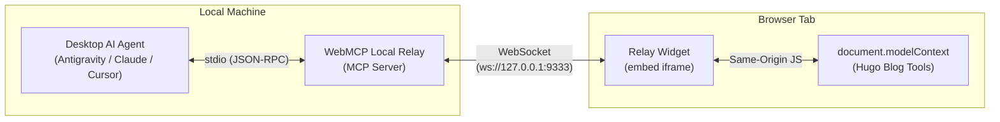
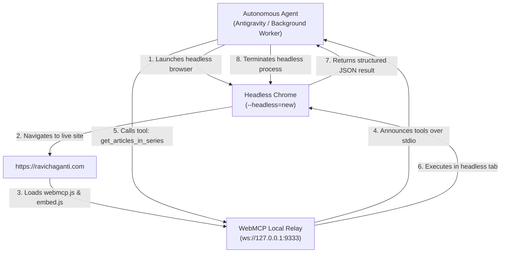

# Connecting Desktop AI Agents to Hugo with WebMCP Local Relay


In our [previous article](https://ravichaganti.com/blog/adding-webmcp-support-to-hugo-static-sites/), we implemented WebMCP support on a Hugo static site. By using the imperative `document.modelContext.registerTool` API, we turned a static blog into a programmable tool provider for AI agents—exposing tools like `list_article_series`, `get_articles_in_series`, and `get_article_content`.

Testing those tools in the browser's developer console (`F12`) or via headless browser automation like Playwright worked as expected.

However, a fundamental limitation quickly emerged. I wanted to use the tools with a desktop coding agent. When you use desktop coding assistants and AI environments like Antigravity, Claude Desktop, or Cursor, they don't live inside your browser tab. They speak the standard [Model Context Protocol](https://ravichaganti.com/blog/anthropic-model-context-protocol/) over `stdio` or HTTP/SSE. They cannot execute JavaScript inside an active browser tab on their own.

In this article, we explore how WebMCP Local Relay bridges this gap and look at the exact changes we made to our Hugo blog's WebMCP implementation so desktop AI agents can discover and call in-browser tools in real time.

## The Architectural Gap

To understand why a bridge is required, compare the two execution environments:

1. **In-Browser WebMCP**: Tools run in the visitor's browser tab. They have direct access to the DOM, local storage, tab state, and fast client-side `fetch()` calls against static JSON feeds.
2. **Desktop AI Assistants**: Tools run as independent processes communicating with the model host via JSON-RPC 2.0 over standard input/output (`stdio`).

If you have a tab open to `https://ravichaganti.com`, how does an AI assistant running in your terminal or IDE talk to the JavaScript runtime inside that tab?



This is where WebMCP Local Relay (`@mcp-b/webmcp-local-relay`) from the [MCP-B project](https://mcp-b.ai/) comes in.

## How WebMCP Local Relay Works

WebMCP Local Relay acts as a dual-sided proxy:

1. On the Desktop: It registers as a standard MCP server in your AI client's configuration (`mcp_config.json`) using `stdio`:
   ```json
   {
     "mcpServers": {
       "webmcp-local-relay": {
         "command": "npx.cmd",
         "args": ["-y", "@mcp-b/webmcp-local-relay@latest"]
       }
     }
   }
   ```
2. In the Background: It starts a local WebSocket server listening on `127.0.0.1:9333`.
3. In the Webpage: A lightweight embed script loads a hidden same-origin iframe (`widget.html`). This widget opens a WebSocket connection to `ws://127.0.0.1:9333`.
4. The Handshake:
   - The tab announces itself (`hello`).
   - The relay requests the active tool inventory.
   - The widget inspects `window.parent.document.modelContext.getTools()` and registers them with the relay.
   - When the desktop agent calls a tool (`webmcp_call_tool`), the relay sends an `invoke` message across the WebSocket, the in-tab widget executes the function in the page context, and the JSON result flows back to your desktop AI assistant.

When we first pointed our local relay to our initial Hugo WebMCP implementation, `webmcp_list_tools` returned zero tools. Here are the three hurdles we encountered and how we resolved them:

### The Missing Embed Bridge Script

A website registering tools on `document.modelContext` doesn't automatically know a local relay is running on the user's machine. The webpage must actively include the relay's embed script:

```html
<script defer src="https://cdn.jsdelivr.net/npm/@mcp-b/webmcp-local-relay@6/dist/browser/embed.js"></script>
```

This 3KB script does three things:
- It generates a persistent `tabId` stored in `sessionStorage`.
- It fetches `widget.html` and creates a hidden Blob iframe inheriting the host page's origin.
- It automatically reconnects to `ws://127.0.0.1:9333` when tabs regain focus.

### The `EventTarget` & `toolchange` Requirement

In our initial implementation, our polyfill for `document.modelContext` was a plain JavaScript object:

```javascript
// Initial naive polyfill:
document.modelContext = {
  async registerTool(toolDef) { ... },
  async getTools() { ... },
  async executeTool(name, params) { ... }
};
```

When the relay's widget initialized, it executed:

```javascript
const mc = window.parent.document.modelContext;
if (typeof mc?.addEventListener === 'function') {
  mc.addEventListener('toolchange', refreshTools);
}
```

Because our polyfill was not an `EventTarget`, it lacked `addEventListener`. Also, when we registered our tools asynchronously after page load, no `toolchange` event was emitted. The widget checked for tools once before our async `initTools()` finished, found nothing, and never refreshed!

The fix is to ack the polyfill with an `EventTarget` instance and dispatch `toolchange` whenever tools are registered or unregistered:

```javascript
const eventTarget = typeof EventTarget !== 'undefined' ? new EventTarget() : null;

document.modelContext = {
  addEventListener(type, listener, options) {
    if (eventTarget) eventTarget.addEventListener(type, listener, options);
  },
  removeEventListener(type, listener, options) {
    if (eventTarget) eventTarget.removeEventListener(type, listener, options);
  },
  dispatchEvent(event) {
    return eventTarget ? eventTarget.dispatchEvent(event) : true;
  },

  async registerTool(toolDef, options) {
    registry.set(toolDef.name, toolDef);
    // Notify the relay widget that tool inventory has updated
    if (eventTarget) eventTarget.dispatchEvent(new Event('toolchange'));
    return true;
  },

  async unregisterTool(name) {
    const deleted = registry.delete(name);
    if (deleted && eventTarget) {
      eventTarget.dispatchEvent(new Event('toolchange'));
    }
    return deleted;
  }
};
```

Under the latest W3C WebMCP draft specification and in `@mcp-b/webmcp-local-relay`, the caller passes the registered tool descriptor object directly:

```javascript
// Inside the relay widget:
let descriptor = tools.find(t => t.name === toolName);
document.modelContext.executeTool(descriptor, args);
```

Passing an object `{ name: "list_article_series", ... }` into `registry.get(descriptor)` caused the lookup to fail silently because `Map.prototype.get()` checks object identity, not properties!

We can fix this by making `executeTool` polymorphic so it accepts either a descriptor object or a plain string name:

```javascript
async executeTool(toolOrName, params = {}, options = {}) {
  const name = typeof toolOrName === 'string' 
    ? toolOrName 
    : (toolOrName && toolOrName.name ? toolOrName.name : '');

  const tool = registry.get(name);
  if (!tool) {
    throw new Error(`WebMCP: Tool '${name}' not found.`);
  }
  return await tool.execute(params);
}
```

## Integrating the Changes into Hugo

With these adjustments in place, updating our Hugo site required only two clean file edits:

### Updating `themes/ravikanth-theme/layouts/_default/baseof.html`

Add the relay embed script directly beneath `webmcp.js`:

```html
  {{/* WebMCP Script - Model Context Protocol for AI Agents */}}
  <script defer src="{{ "/js/webmcp.js" | relURL }}"></script>

  {{/* WebMCP Local Relay Embed - Bridges browser tab tools to local MCP clients (Antigravity, Claude, Cursor) */}}
  <script defer src="https://cdn.jsdelivr.net/npm/@mcp-b/webmcp-local-relay@6/dist/browser/embed.js"></script>
```

### Updating `static/js/webmcp.js`

Add `EventTarget` delegation, `toolchange` dispatching, and polymorphic descriptor handling to the polyfill layer.

## The Live Result in Antigravity

With Hugo running (`hugo server`) and `http://localhost:1313` open in a browser tab, we asked Antigravity:

> *"Get me a list of all series on my blog"*

Here is what occurred behind the scenes:

1. Tab Discovery: Antigravity queried `webmcp_list_sources`:
   ```json
   {
     "count": 1,
     "sources": [
       {
         "tabId": "fe13bab9-ac31-4169-a279-7884faa0c488",
         "origin": "http://localhost:1313",
         "title": "Ravikanth Chaganti",
         "toolCount": 5
       }
     ]
   }
   ```
2. Tool Discovery: Antigravity called `webmcp_list_tools` and discovered the 5 blog tools (`list_article_series`, `get_articles_in_series`, `search_articles`, `get_article_content`, and `get_author_info`).
3. Execution: Antigravity invoked `webmcp_call_tool`:
   ```json
   {
     "name": "list_article_series",
     "arguments": {}
   }
   ```
4. The relay routed the call over the WebSocket into the live browser tab. The in-page JavaScript evaluated `list_article_series()`, read the cached `/series/index.json`, and returned all 37 technical series directly into Antigravity's chat context!

## Headless WebMCP Without Human Interaction

While having an open browser tab is great when you are actively browsing or pair-programming with your AI, it raises a fundamental question:

> Imagine an autonomous shopping agent buying products from an eCommerce site with WebMCP tools, or a background research agent surveying technical documentation. An agent cannot wait for a human to sit down and open a browser tab.

The solution is ephemeral headless browsing. Instead of waiting for a human, the autonomous agent launches a lightweight headless browser instance (using Chrome `--headless=new` or Playwright) targeting the live website:



I tested this autonomous headless pattern against this blog site (`https://ravichaganti.com`):

**Launching Headless Chrome in the Background**:

```powershell
chrome.exe --headless=new --disable-gpu --allow-running-insecure-content --remote-debugging-port=9222 "https://ravichaganti.com"
```

**Autonomous Relay Discovery**:
Without any visible browser window or human interaction, the headless Chrome process loaded `https://ravichaganti.com`, executed `embed.js`, and connected to the local relay.

Antigravity immediately observed the new source via `webmcp_list_sources`:
```json
{
  "count": 1,
  "sources": [
    {
      "tabId": "e6b36c71-bdfc-4fe1-b671-2232e7b20815",
      "origin": "https://ravichaganti.com",
      "url": "https://ravichaganti.com/",
      "title": "Ravikanth Chaganti",
      "toolCount": 5
    }
  ]
}
```

**Autonomous Execution on the Live Production Site**:
Antigravity invoked `get_articles_in_series` on the headless instance and received structured JSON data directly from the live production site:

```json
{
  "series": "Model Context Protocol",
  "articleCount": 3,
  "url": "https://ravichaganti.com/series/model-context-protocol/",
  "articles": [
    {
      "date": "2025-02-01",
      "title": "Model Context Protocol by Anthropic for connecting AI models to data",
      "markdown_url": "/blog/anthropic-model-context-protocol/index.md"
    },
    {
      "date": "2025-02-25",
      "title": "Building a Model Context Protocol server for Azure",
      "markdown_url": "/blog/building-a-model-context-protocol-server-for-azure/index.md"
    },
    {
      "date": "2026-10-12",
      "title": "Adding WebMCP Support to Hugo Static Sites",
      "markdown_url": "/blog/adding-webmcp-support-to-hugo-static-sites/index.md"
    }
  ]
}
```

Once the task finished, Antigravity terminated the headless browser process. The relay cleanly unregistered the tools until the next session.

This architecture unlocks a massive paradigm shift for the agentic web:

- **Zero Fragile Screen Scraping**: Autonomous agents no longer need to rely on vision models, brittle DOM selectors, or simulated mouse clicks. Tools are schema-driven, typed, and deterministic.
- **Unified Tool Implementation**: The exact same WebMCP tools serve both interactive humans (pair-programming with local browser tabs) and fully autonomous headless agents running unattended tasks.
- **Zero Cloud Infrastructure**: You do not need to build, deploy, or maintain dedicated REST microservices or cloud MCP servers. Static sites hosted on CDNs or GitHub Pages become first-class AI tool providers.
- **Standards Convergence**: By implementing the proposed W3C WebMCP `document.modelContext` standard on the web side and the Model Context Protocol standard on the agent side, websites remain future-proof for native browser AI agents while delivering immediate utility today.

